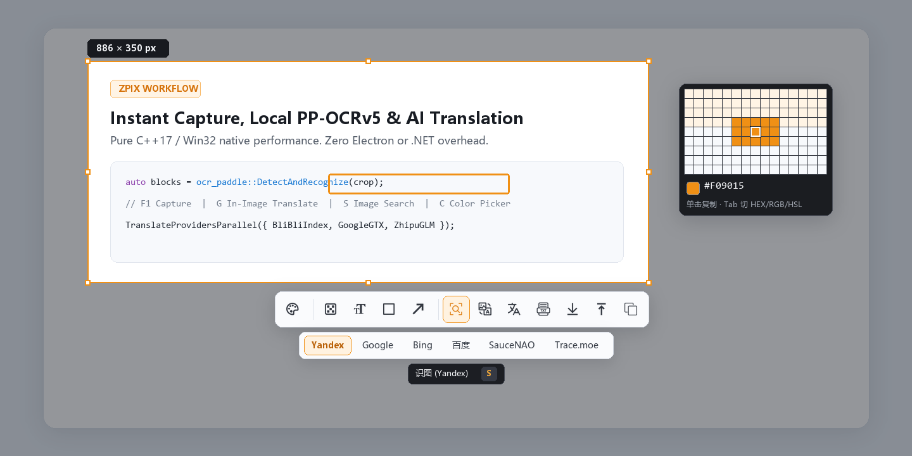
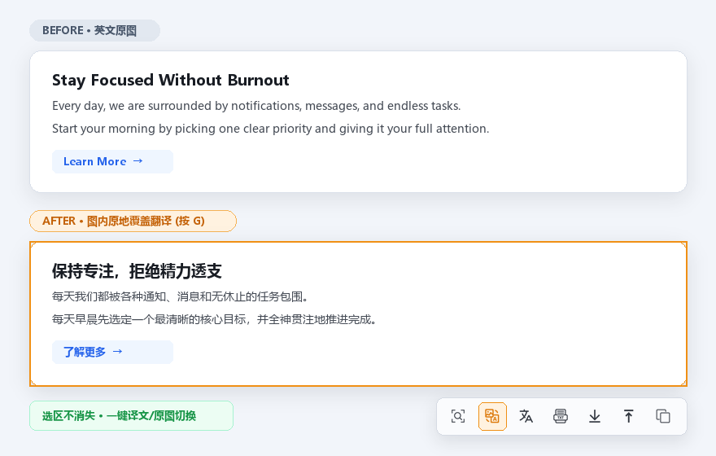
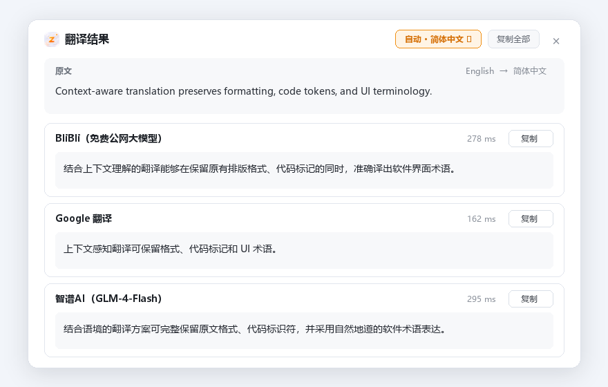
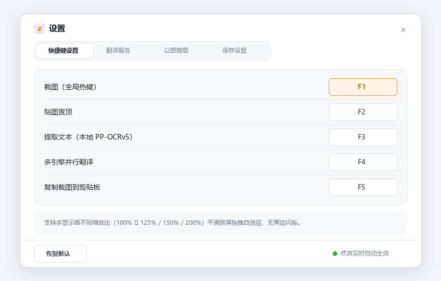

<div align="center">


# Zpix

### 轻量、极速的原生截图、贴图、本地 OCR、图内翻译与以图搜图工具

截图贴图 · 本地 PP-OCRv5 · 图内原地覆盖翻译 · 全局划词翻译 · 六大引擎识图

<br />

[](https://github.com/Zpix426/Zpix/releases)
[](windows/)
[](mac/)
[](windows/src/)
[](windows/src/ocr_paddle.cpp)
[](LICENSE)

<br />

**[下载安装包 (Releases)](https://github.com/Zpix426/Zpix/releases)** ·
[功能亮点](#功能亮点) ·
[快速上手](#快速上手) ·
[快捷键速查](#快捷键速查) ·
[目录结构](#目录结构) ·
[从源码构建](#从源码构建)

<br />



</div>

**Zpix** 是一款拒绝臃肿运行时的桌面效率工具。Windows 客户端采用纯 **C++17 / Win32 / GDI+** 原生构建（无 Electron、无 .NET、无 WebView 内存负担），单程序体积仅 **~1.2 MB**，内置本地离线 **PP-OCRv5** 文字识别引擎，集成**图内原地覆盖翻译**、**多引擎并行翻译**、**全局划词翻译**、**六大平台以图搜图**与**像素级放大取色器**。

> [!TIP]
> 开箱即用：默认启用免 Key 的 **BliBli 大模型翻译**与 **Google 翻译**，安装后无需繁琐配置即可直接使用截图翻译、图内翻译与全局划词翻译；也可随时在设置页接入智谱 GLM 或任意 OpenAI 兼容接口。

---

## 功能亮点

<table>
<tr>
<td width="50%" valign="top">

<p align="center"><b>图内原地覆盖翻译（按 G）</b><br />自动识别图中外文段落、智能擦除背景并按原字重与配色回填中文；翻译后选区不消失，支持一键切换「译文 / 原图」并继续贴图、复制或保存。</p>
</td>
<td width="50%" valign="top">

<p align="center"><b>多引擎并行翻译 &amp; 全局划词</b><br />一次请求并行调用多个翻译服务（BliBli / Google / 智谱 AI / 自定义 OpenAI），支持中英及多语种自动双向互译与全局鼠标划词悬浮翻译。</p>
</td>
</tr>
<tr>
<td width="50%" valign="top">

<p align="center"><b>六大引擎以图搜图（按 S）</b><br />集成 Yandex、Google Lens、Bing、百度、SauceNAO（插画溯源）、Trace.moe（番剧定帧），采用 10 分钟自动销毁的临时直链保护隐私。</p>
</td>
<td width="50%" valign="top">

<p align="center"><b>实时自动生效 &amp; 多屏高分自适应</b><br />纯白现代自绘设置面板，所有修改实时生效无需手动保存；完美适配多显示器混合缩放比（100% ↔ 125% / 150% / 200%）平滑跨屏拖拽。</p>
</td>
</tr>
</table>

---

## 核心特性一览

- **智能窗口与元素级框选**：支持顶层窗口、浏览器/微信内部卡片与 UIA 子控件自动探测，滚轮可逐级缩放命中层级，选区锁定后支持 8 方向微调与方向键 `1px` 像素级移动。
- **置顶贴图（Pin）**：一键将选区（含标注或图内译文）钉在屏幕最前，支持鼠标锚点无级滚轮缩放（`10% ~ 800%`）、多档透明度调节、快捷键复制与另存。
- **像素级放大取色器（按 `C`）**：`15×9` 实时像素网格准星放大镜，支持按 `Tab` 循环切换 `HEX` / `HEXA` / `RGB` / `RGBA` / `HSL` / `HSLA` 六种色值格式并单击复制。
- **轻量实时标注**：内置箭头、矩形、马赛克、无底色实时输入文本（支持输入法跟随光标）及多档粗细/配色调节。
- **本地离线 PP-OCRv5 识别**：内置中英日等多语种高精度离线检测与识别引擎，断网环境同样秒级提取屏幕文字。
- **按日自动归档留存**：每次截图可按 `YYYY-MM-DD/Zpix_YYYYMMDD_HHMMSS.png` 自动分类归档，下载完成后可选自动定位并选中文件。

---

## 快速上手

### 方式一：直接安装（推荐）

1. 前往 **[GitHub Releases](https://github.com/Zpix426/Zpix/releases)** 下载最新安装包 **`ZpixSetup.exe`**。
2. 双击运行安装向导（支持自定义安装路径、桌面快捷方式与开机自启）。
3. 安装完成后会自动打开「设置 → 翻译服务」：
   - **免配置即用**：默认已开启 **BliBli** 与 **Google 翻译**。
   - **可选增强**：如需启用 **智谱 AI（GLM-4-Flash 免费模型）** 或 **以图搜图（ImgBB 免费直链 Key）**，点击对应卡片右上角「免费获取 API Key」创建后粘贴即可实时生效。

### 方式二：静默部署 / 卸载命令

```powershell
# 静默安装到指定目录
ZpixSetup.exe /silent /dir "D:\Apps\Zpix"

# 卸载（也可直接双击安装目录下的 uninstall.exe 或在系统“应用和功能”中卸载）
"C:\Program Files\Zpix\uninstall.exe"
```

---

## 快捷键速查

### 全局热键（可在设置中自定义）

| 操作 | 默认热键 | 说明 |
| :--- | :--- | :--- |
| **发起截图** | `F1` | 冻结全虚拟桌面并进入智能框选模式 |

### 截图工具栏内快捷键

| 按键 | 功能 | 说明 |
| :--- | :--- | :--- |
| `F2` / `Enter` | **贴图** | 将选区置顶钉在桌面上（滚轮缩放、`Esc` 关闭） |
| `F3` | **提取文本** | 本地 PP-OCRv5 识别选区文字并复制到剪贴板 |
| `F4` | **翻译** | 提取文字并打开多引擎并行翻译结果窗 |
| `F5` | **复制** | 将选区图像（含标注/译文）复制到剪贴板 |
| `G` | **图内翻译** | 在选区内原地擦除并覆盖渲染译文，再按切换译文/原图 |
| `S` | **识图** | 关闭截图窗并在浏览器打开默认识图引擎（悬停图标可换厂家） |
| `C` | **取色** | 开启像素放大镜，单击复制色值，按 `Tab` 切换颜色格式 |
| `M` / `T` / `R` / `A` | **标注工具** | 马赛克 / 输入文本 / 矩形 / 箭头 |
| `Ctrl + S` | **下载** | 保存 PNG 到本地按日归档目录 |
| `方向键` / `Esc` | **微调 / 退出** | `1px` 微调选区位置（`Ctrl+方向键` `5px`），右键或 `Esc` 退出 |

---

## 目录结构

仓库按跨平台多端结构组织：

```text
Zpix/
├── windows/                 # Windows 原生客户端（C++17 / Win32 / GDI+）
│   ├── src/                 # 核心源码（截图覆盖层、贴图、PP-OCRv5、图内翻译、识图、设置页与安装器）
│   ├── third_party/         # ONNX Runtime C/C++ 头文件与 PP-OCRv5 字典
│   └── build.bat            # MinGW-w64 一键构建与安装包打包脚本
├── mac/                     # macOS 原生客户端目录（规划与开发中）
├── docs/images/             # 产品文档与界面预览资源
├── .github/workflows/       # GitHub Actions 自动构建与 Release 发布工作流
├── LICENSE                  # MIT 开源许可证
└── README.md
```

---

## 从源码构建（Windows）

### 环境准备

1. 下载并解压 **[w64devkit](https://github.com/skeeto/w64devkit/releases)**（MinGW-w64 GCC 13+ 工具链，无需安装庞大的 Visual Studio），将其 `bin` 目录加入 `PATH`（或修改 `windows/build.bat` 中的 `TOOLCHAIN` 路径）。
2. 如需打包完整离线 PP-OCRv5 安装器，将以下运行时模型文件放入 `windows/build/model/`：
   - `onnxruntime.dll`（ONNX Runtime Windows x64 动态库）
   - `det.onnx`、`rec.onnx`（PP-OCRv5 检测与识别 ONNX 模型）
   - `ppocr_keys.txt`（已随仓库附带于 `windows/third_party/ppocr/ppocr_keys.txt`）

### 编译命令

```bat
cd windows
build.bat
```

构建产物输出在 `windows/build/`：
- `Zpix.exe`：单文件便携主程序
- `ZpixSetup.exe`：内嵌模型与卸载器的完整单文件安装程序

---

## 如何上传安装包到 GitHub Release

提供**网页手动上传**与**Git Tag 自动发布**两种方式：

### 方式 A：在 GitHub 网页直接上传（最直观，推荐）

1. 打开仓库页面 **`https://github.com/Zpix426/Zpix/releases`**，点击右上角 **`Draft a new release`**。
2. 点击 **`Choose a tag`**，输入版本号（例如 `v0.4.0`），点击 **`Create new tag: v0.4.0 on publish`**。
3. 填写标题（例如 `Zpix v0.4.0`）和更新说明。
4. 将本地编好的 **`ZpixSetup.exe`**（以及可选的便携版 `Zpix.exe`）直接拖入底部的 **`Attach binaries by dropping them here or selecting them`** 区域，等待进度条走完。
5. 点击绿色按钮 **`Publish release`** 即可生成永久下载直链！

### 方式 B：用 GitHub CLI 一行命令上传

如果本机安装了 [GitHub CLI (`gh`)](https://cli.github.com/) 并已 `gh auth login`：

```powershell
gh release create v0.4.0 build\ZpixSetup.exe build\Zpix.exe --title "Zpix v0.4.0" --notes "首发 Windows 安装包与便携版"
```

---

## 开源许可

本项目基于 [MIT License](LICENSE) 开源。
